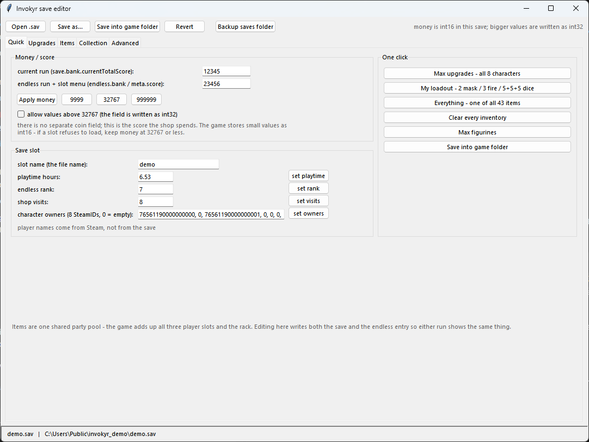

# Invokyr Save Editor

**This code is AI-generated (vibecoded) — see [How this was made](#how-this-was-made).**
Tested against Steam build `26154962` — see [Verified against](#verified-against).

An unofficial, dependency-free save editor for **Invokyr** (Ludogram). Reads and writes
`.sav` files directly — no game install access, no memory patching, no launcher.



```
save 1.sav  = ZIP (deflate, no password, no encryption)
    meta        MessagePack map  - save-slot header (seen by the load menu)
    save        MessagePack map  - normal run state
    endless     MessagePack map  - endless run state
    collection  MessagePack map  - permanent progression
```

No checksum, no signature, no obfuscation: every byte of all four entries parses as one
exact MessagePack value. The format is written up in [docs/FORMAT.md](docs/FORMAT.md),
the item and upgrade tables in [docs/ITEMS.md](docs/ITEMS.md).

## Features

| Tab | What it does |
|---|---|
| **Quick** | money/score, save-slot name, playtime, endless rank, shop visits, character owners (which SteamID plays which character), one-click max upgrades / loadouts / figurines |
| **Upgrades** | per-character levels, capped at the real asset maximums (Health 8, Stamina 7, Speed 5, Item slots 2) |
| **Items** | the shared party pool: add or remove any of the build's 43 item ids, per pool, with battery levels |
| **Collection** | figurines as 20 checkboxes, completed boards and difficulties, house rules, furniture, room skin |
| **Advanced** | the raw tree — double-click any field and edit it as JSON, with a consistency check that enforces every rule the format implies |

Everything is written to both the `save` and `endless` entry, so whichever run you load
shows the same state.

## Requirements

* Windows (the default paths are Windows paths; the code itself is portable)
* Python 3.9+ with tkinter — the python.org installer includes it
* Nothing to `pip install`

## Run

**No Python installed?** Grab `InvokyrSaveEditor-0.1.0-win64.zip` from the
[releases page](../../releases) and run `InvokyrSaveEditor.exe` — one file, nothing to
install. It is the same program, built with PyInstaller.

From source, double-click **`Invokyr Save Editor.bat`** (it prefers `pythonw`, so no console
window), or:

```
python invokyr_gui.py                 # opens save 1.sav
python invokyr_gui.py "C:\path\to\other.sav"
```

Command line, no GUI:

```
python invokyr_save.py dump  <sav> [-o dump.json]                    # everything as JSON
python invokyr_save.py check <sav>                                   # byte-exact roundtrip test
python invokyr_save.py set   <sav> -o out.sav "entry.path=value" ...  # edit inline
python invokyr_save.py apply <sav> <patch.json> -o out.sav           # edit from JSON
```

Paths use `map.key`, `arr[3]`, nested both ways:
`save.playerInventories[2].itemStringIds`. Values are JSON, so `5`, `-1`, `1.5`, `true`,
`"dice_heal"`, `["a","b"]` all work. `-o` is mandatory: the tool never writes over its input.

Presets in `presets/`:

```
python invokyr_save.py apply "<sav>" presets\rich.json       -o out.sav   # score 999999 everywhere
python invokyr_save.py apply "<sav>" presets\collection.json -o out.sav   # all figurines, rank 20
python invokyr_save.py apply "<sav>" presets\tools.json      -o out.sav   # full tool belt
```

## Where the saves are

```
%USERPROFILE%\AppData\LocalLow\Ludogram\Invokyr\saves\*.sav
```

The **file name is the slot name** — the game lists `save 1 - Copy.sav` as
`save 1 - Copy`, and its rename button just renames that file. Player names come from
Steam and are not in the save at all.

## Safety

* The editor never touches the game install and never writes to the file it opened.
* **Save as...** writes where you point it. **Save into game folder** writes
  `<slot name>.sav` into `saves/`, asks first, and copies any existing file to
  `saves/_backup_<timestamp>/` before replacing it.
* Every write is verified: the file is read back and compared field by field, and the
  status bar says `(verified)`.
* Close the game before replacing a slot — it rewrites the file when it saves, and the
  status bar warns you when `Invokyr.exe` is running.
* Invokyr uses **Steam Auto-Cloud** (`saves/steam_autocloud.vdf`). If Steam holds a newer
  copy it can win on the next launch, so quit the game, let Steam finish syncing, and keep
  a manual backup of `saves/` before you experiment.
* Editing your own offline save is the whole point. Nothing here bypasses anything online.

## Verified against

| | |
|---|---|
| Game | Invokyr **0.44.14**, Steam appid `3883570` |
| Steam build | **`26154962`** (last updated 2026-10-23 10:57 UTC) |
| Engine | Unity 6000.3.14f1 |
| Save format | `version` 15 |
| Tested on | Windows 11 64-bit (10.0.26100), 2026-10-26 |
| Distribution | Steam (PC). No other store or platform was tested. |

The version string is the `bundleVersion` from `Invokyr_Data/globalgamemanagers`
(`0.44.14`), and it matches Ludogram's "Patch V0.44.14" announcement, posted about two hours
before that depot update. The build id and update time come from `appmanifest_3883570.acf`.

Everything below — the field map, the 43 item ids, the upgrade caps, the garage data — was
read out of that build's own addressables bundles, and edited saves were loaded in that build
on that machine. A different build can rename items, change the field set or bump the save
version: run `python invokyr_save.py check "<your save>"` first, and if a slot refuses to
load, assume the build moved rather than the save being broken.

## How this was made

**Every line of code here was written by an AI agent — DeepSeek — from a human operator's
direction.** That is worth saying plainly, because it changes how you should read this repo:

* The format knowledge is evidence-backed, not guessed. Each field was confirmed by
  re-encoding real saves byte for byte (`python invokyr_save.py check`) and by loading edited
  saves in the game. Where something could not be confirmed — money above 32767, key doors —
  it is marked as untested in [Known limits](#known-limits).
* The code itself has not been reviewed line by line by a human, and the usual "someone
  would have caught that" argument does not apply. It is plain Python with no dependencies
  and no build step, about 2 000 lines, so it can be read in an afternoon.
* The blast radius is small on purpose: it opens one file you choose, writes files next to
  it, keeps a timestamped backup, and verifies what it wrote. It has no network access, no
  installer, no background process and no elevation.

If you find a claim below that the code or the game contradicts, that is a bug: open an
issue with the build id and the command you ran.

## Known limits

* `unlockedKeyDoors` (`List<Door.KeyName>`) is empty in every save sample, so its element
  encoding is unknown and the editor leaves it alone. Unlock one key door in a run and save,
  and that question is answered.
* **Double jump does not exist in the code.** The build ships a `CharacterUpgrade_DoubleJump`
  asset with an empty level table and a shop path string, but no air-jump counter anywhere in
  the il2cpp metadata (`AirJump`, `MaxJumps`, `jumpCount`, `ExtraJump`, `MultiJump`: all
  absent). Probe saves at every unused upgrade index load fine and do nothing.
* Money is stored as int16 while it is small (`6943` = `d1 1b 1f`). Values above 32767 are
  written as int32 and need the checkbox; if a slot ever refuses to load, keep money at 32767
  or below. This is the one thing that could not be tested without the game.
* `meta` mirrors the **endless** run, not the normal one. Editing `endless.*` without fixing
  `meta.*` leaves a stale score/rank in the slot menu — the consistency check flags it.

## Contributing

Issues and PRs welcome. If you report a bug, include the game build, the save format
version (`version` field), and the output of `python invokyr_save.py check <your save>`.
Please don't attach full saves — they contain SteamIDs.

## Testing

No save file is needed — `tests/make_save.py` builds one from scratch:

```
python tests/make_save.py demo.sav           # synthetic save, made-up values
python invokyr_save.py check demo.sav        # byte-exact roundtrip of all four entries
python invokyr_gui.py --selftest demo.sav    # drives every widget: load, money mirror,
                                             # upgrade caps, item pool, collection edits,
                                             # dialogs, invalid input, filter, consistency
                                             # rules, write, reload
```

The selftest exits non-zero on the first failure. Against a real save it is the stronger
test, because the encoder then has to preserve the game's own integer widths.

## Credits

| | |
|---|---|
| **Talentless-Rift** | project, direction, in-game testing, real saves, release |
| **DeepSeek** (AI coding assistant) | save-format reverse engineering, `invokyr_save.py`, `invokyr_gui.py`, docs, tests |

Every code path in this repo was produced by the AI agent named above, working from the
human's saves and the game's own asset bundles. The game is by [Ludogram](https://store.steampowered.com/app/3883570/);
no game code or assets are included or redistributed here.

## Disclaimer

Unofficial and not affiliated with Ludogram. Contains no game code or assets, only the
format knowledge needed to read and write a save file. Use it on your own saves, back them
up first.

## License

MIT — see [LICENSE](LICENSE).
